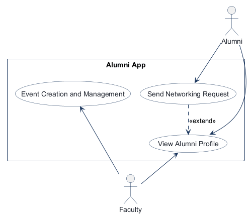
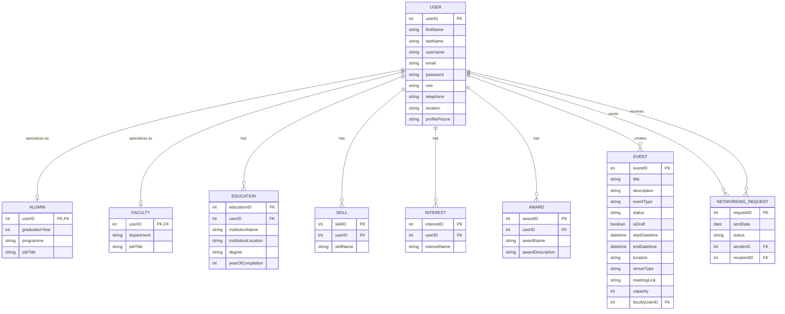
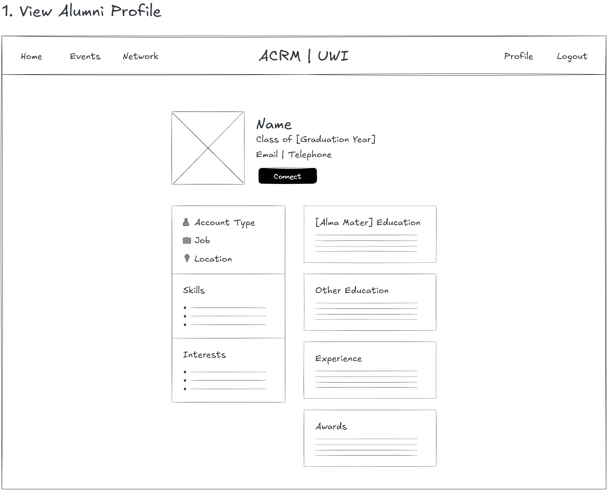
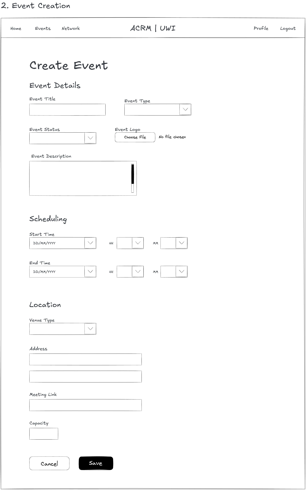
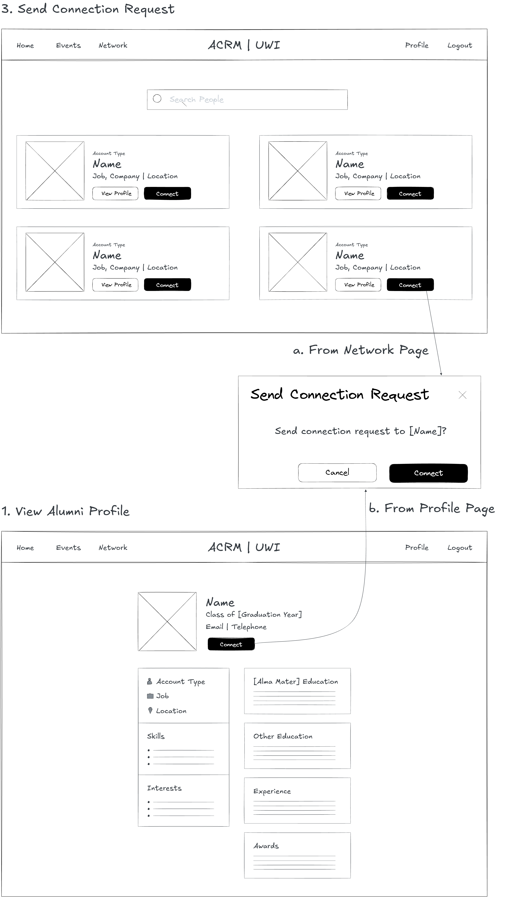
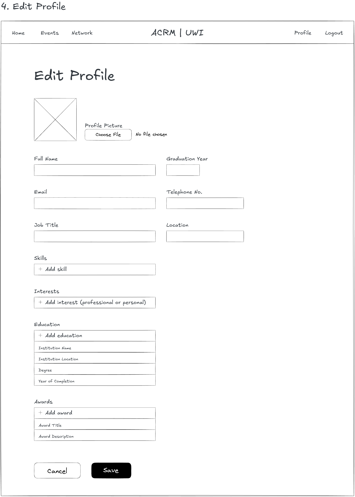

# COMP 3613 Assignment 1

Draft this file with the Guide. **Update it after every phase milestone** before you pause. The use-case diagram is a UML PNG at `docs/diagrams/use-case.png`, linked from this file as `diagrams/use-case.png` (path relative to `docs/report.md`). The model diagram is Mermaid. **Embed wireframe images** as `wireframes/<file>` (files live in `docs/wireframes/`).

Do not put your student ID in this file if you will commit it. The PDF cover adds your name and ID at export time.

## Assigned project

Alumni App

## Workflows

### 1. View Profile (Alumni, Faculty)

### 2. Event Creation and Management (Faculty)

### 3. Send Connection Request (Alumni)

### 4. Edit Profile (Alumni, Faculty)

## Use case diagram

Notes:
- `View Profile` is a shared capability used across actors.
- `Send Connection Request` is a separate workflow and can optionally extend `View Profile` when the user inspects a profile before sending a request.
- `Event Creation and Management` is a separate faculty workflow and does not need to be tied to the alumni networking flow.

## Model diagram

First draft from the student-named entities, properties, and confirmed relationships. Update this section in Phase 5 when polish revises the model, and note what changed.

Notes:
- `User` holds the shared account and contact fields. `Alumni` and `Faculty` specialize it through a shared primary key/foreign key. Both roles use the profile detail tables; only Alumni has graduation year and programme.
- A User can have multiple Education, Skill, Interest, and Award records. A Faculty User can create multiple Events; each Event has one owning User.
- Each Networking Request has one sender and one recipient, both of whom are Users. Users can send and receive multiple requests.
- Networking Request status values: `pending`, `accepted`, `rejected`. Accepting updates the existing request into a connection. A repeated request in either direction is not allowed. Incoming requests appear in My Network for acceptance or rejection; accepted requests appear as connections.
- Event fields now include type, draft state, start/end datetimes, venue type, meeting link, and capacity. Event status is an explicit faculty choice (`upcoming`, `tentative`, or `cancelled`) and is shown exactly as selected. A faculty owner can also delete their own events from My Events.

## Wireframes

### 1. View Profile

### 2. Event Creation and Management

### 3. Send Connection Request

### 4. Edit Profile

Coverage notes:
- `View Profile` shows a profile detail layout with a `Connect` action and the profile metadata cards.
- `Event Creation and Management` shows the full faculty event form, including title, type, status, description, scheduling, venue, and save/cancel actions.
- `Send Connection Request` shows both entry points: from the network search page and from the profile page, with a confirmation modal before sending the request.
- `Edit Profile` covers shared identity/contact fields, profile picture, Alumni graduation year, job title, skills, interests, education entries, awards, and Save/Cancel. The affiliated programme remains an Alumni model field and will be included in the form.
- The wireframes cover all four named workflows. The confirmed post-save destination for the faculty event workflow is: after `Save`, the user returns to the event list view.

## Theming

Branding preferences and how they were applied (landing / login / register).

- Platform name: Nexa
- Color palette:
  - Primary: `#102F4A`
  - Accent: `#D1AD6B`
  - Main background: `#F7F5F0`
  - Content surfaces: `#FFFFFF`
  - Body text: `#344054`
  - Borders: `#D9E4EC`
- Font family: Geist Sans
- Applied direction: clean, trust-focused alumni network branding with a premium academic feel, using deep navy for primary actions, warm gold acccent highlights, and quiet neutral surfaces for readable cards and forms.

## Implementation notes

One named workflow at a time. Include verify notes and polish / model revisions (Phase 5). Do not treat the first build as final.

- **View Profile:** Added an authenticated Network directory with username search and links to profile detail pages. Profile pages show shared contact information, Alumni graduation year/programme, job title/department, and available education, skills, interests, and awards. Verified by the student in the running app; the existing role/event regression tests passed (4 tests).
- **Send Connection Request:** The Network area is divided into Global Network for discovering members and My Network for accepted connections plus incoming and outgoing requests. Connect uses a confirmation modal from both the directory and profile. Duplicate requests in either direction are blocked. The student verified sending and handling requests in the running app; the full test suite passed (6 tests).
- **Edit Profile:** Student wireframe added at `docs/wireframes/w4.png`. Profile edits exclude password and role; registration and profile editing include first and last name. The student confirmed the completed workflow was verified locally.
- **Event Creation and Management:** Implemented faculty event creation and editing, including draft handling, scheduling, venue, and capacity. The student confirmed the completed workflow was verified locally.
- **Event status and deletion (polish):** Added an explicit `upcoming` status option alongside `tentative` and `cancelled`; the selected status is now stored and displayed as-is instead of being overwritten by schedule-based derivation. Fixed the form field mapping so the status dropdown actually reaches the route (`status` form field aliased to the `event_status` parameter). Statuses are shown as colour-coded badges (Upcoming green, Tentative amber, Cancelled red); cancelled events are further emphasised with a red card border and struck-through title and description on both the public Events list and My Events. Added a Delete action with confirmation on My Events, scoped to the owning faculty user (`EventService.delete_event` checks ownership). Covered by service- and endpoint-level regression tests; full suite passed (21 tests).
- **Phase 5 completion:** The student confirmed that all four named workflows are completed and verified locally.
- **Demo data (seed polish):** Seed now keeps `bob` as Alumni and updates the existing `admin` record to Faculty (no duplicate account), adds three fictional Alumni (`alice`, `marcus`, `priya`) and one fictional Faculty (`drstewart`) with education, skills, interests, and awards, three sample events of different types (Social, Mentorship, Reunion) owned by the Faculty account, and two connection requests (one accepted, one pending from `alice` to `bob`). Seeding is idempotent and reuses the existing repositories; running `python manage.py init` again creates no duplicates.

## Deployed app

Phase 6. Public Render URL (not localhost). Markers open this to mark the three workflows.

https://

## Logins

Every account a marker needs, including extra users you added. Seeded via
`app/services/seed_service.py` (idempotent: re-running init/seed never
duplicates users, events, or connection requests).

- bob / bobpass — alumni (Alumni)
- admin / adminpass — faculty (Faculty; can create and manage events)
- alice / alumnipass — alumni (sample)
- marcus / alumnipass — alumni (sample)
- priya / alumnipass — alumni (sample)
- drstewart / facultypass — faculty (sample)

## YouTube URL

## Session transcripts

Filled when the Guide builds the report: the agent writes each Guide chat to `docs/transcripts/<slug>.md` (Copilot Agent, Cursor, or OpenCode). `python manage.py report` packages them. Do not paste chats here during the build.

## Competency (student-judge)

Filled when the report is built. Guide runs student-judge, writes `docs/judge.md`, and export appends the scorecard here.

## Skill integrity

Filled by `python manage.py report`. Do not edit the course skills.
